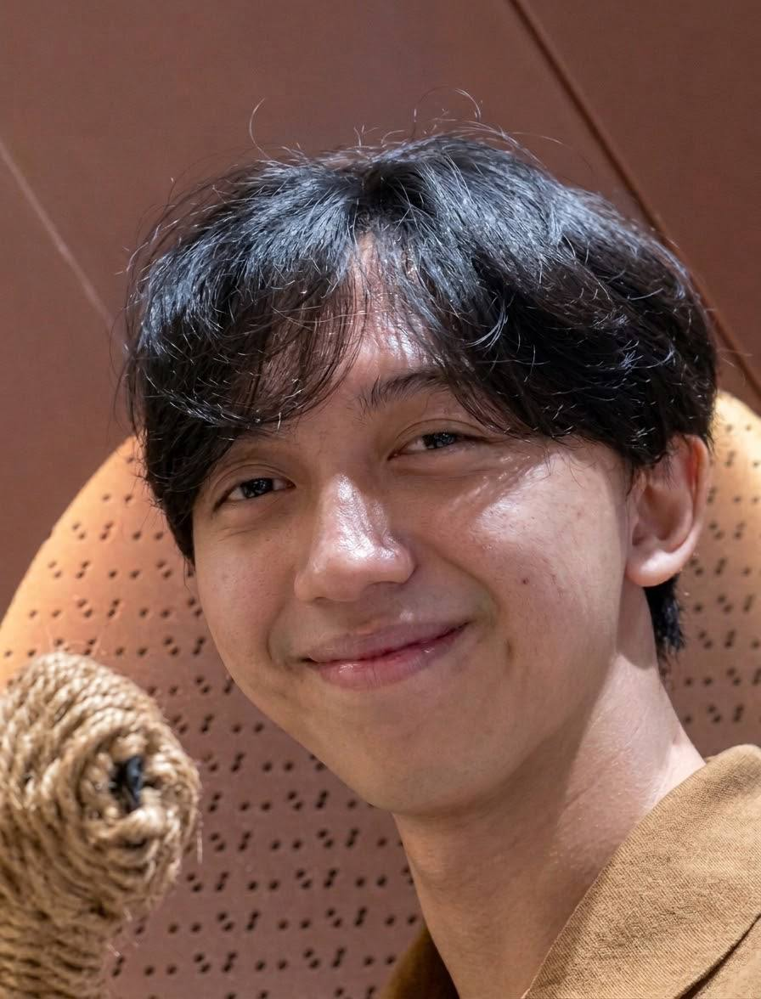
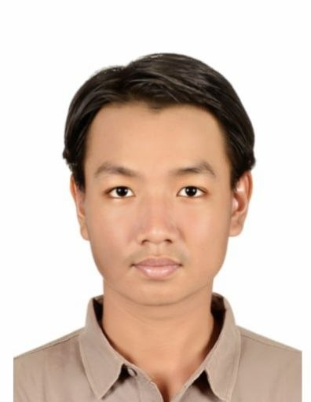
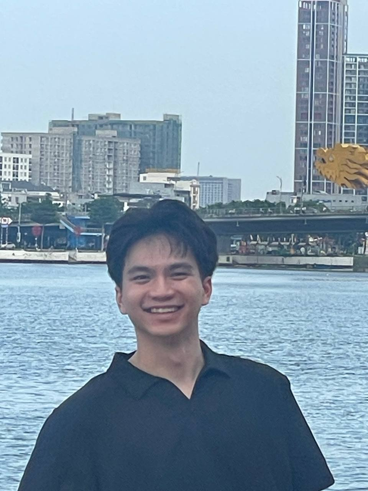
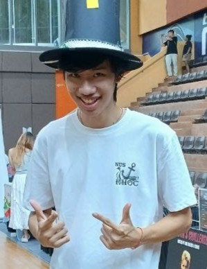
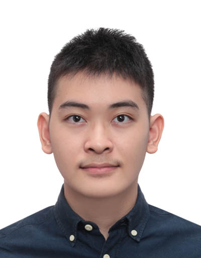

# About Us

We are a team based in the [School of Computing, National University of Singapore](http://www.comp.nus.edu.sg).

You can reach us through the [TuteeDex issue tracker](https://github.com/AY2627S1-CS2103T-F13-2/tp/issues).

## Project team

### Hein Lin Htet

[[github](https://github.com/Henry336)] [[portfolio](team/henry336.md)]

* Role: Team Lead
* Responsibilities: Deliverables and Deadlines, Documentation

### Nay Min Thar

[[github](https://github.com/naymin-gif)] [[portfolio](team/naymin-gif.md)]

* Role: Developer
* Responsibilities: Scheduling and Tracking, Testing

### Alpha

[[github](https://github.com/Alpharion)] [[portfolio](team/alpharion.md)]

* Role: Developer
* Responsibilities: Code Quality, Integration and Releases

### That Li

[[github](https://github.com/ThatLi)] [[portfolio](team/thatli.md)]

* Role: Developer
* Responsibilities: Documentation & Testing, backup Scheduling & Tracking

### Jimmy Li

[[github](https://github.com/jimmylijy12)] [[portfolio](team/jimmylijy12.md)]

* Role: Developer
* Responsibilities: Integration and Releases, Code Quality
