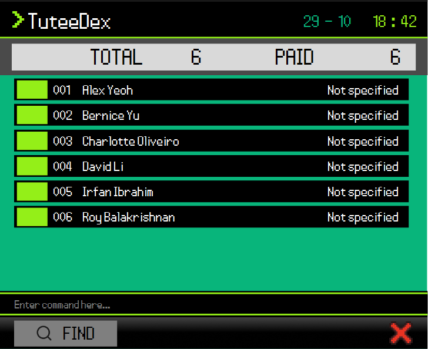

# TuteeDex User Guide

TuteeDex is a **desktop application for private tutors to manage student profiles, optimized for use through a Command Line Interface (CLI)** while retaining the benefits of a Graphical User Interface (GUI). If you type quickly, TuteeDex can help you manage student information faster than traditional GUI applications.

<!-- * Table of Contents -->
<page-nav-print />

--------------------------------------------------------------------------------------------------------------------

## Quick start

1. Ensure that Java `25` or later is installed on your computer. 
   **Mac users:** Ensure you have the precise JDK version prescribed [here](https://se-education.org/guides/tutorials/javaInstallationMac.html).

1. Download the latest `.jar` file from [here](https://github.com/AY2627S1-CS2103T-F13-2/tp/releases).

1. Copy the file to the folder you want to use as the _home folder_ for TuteeDex. 
   Use a folder where you can create files, such as one inside your Documents folder. TuteeDex saves its data there and does not work properly in a write-protected folder.

1. Open a terminal, `cd` to the folder containing the JAR file, and run `java -jar "TuteeDex.jar"`. 
   Use this command rather than double-clicking the JAR file, which might not work on some computers. 
   A GUI similar to the one below should appear in a few seconds. Note how the app contains some sample data. 
   

1. Type a command in the command box and press Enter to execute it. For example, type **`help`** and press Enter to open the help window. 
   Some example commands you can try:

   * `list` : Lists all active contacts.

   * `add n/John Doe p/98765432 a/John street, block 123, #01-01 d/10-Aug s/Maths day/MON time/15:30 o/20` : Adds a student profile named `John Doe` to TuteeDex.

   * `delete 3` : Deletes the 3rd contact shown in the current list.

   * `clear confirm` : Deletes all contacts.

   * `exit` : Exits the app.

1. Refer to the [Features](#features) section below for details of each command.

--------------------------------------------------------------------------------------------------------------------

## Features

<box type="info" seamless>

**Notes about the command format:** 

* Words in `UPPER_CASE` are the parameters to be supplied by the user. 
  For example, in `add n/NAME`, replace `NAME` with a value such as `John Doe`.

* Items in square brackets are optional. 
  For example, `edit INDEX [d/START_DATE]` can be used as `edit 1 d/10-Aug` or as part of an edit containing other optional fields.

* Items followed by `...` can appear zero or more times. 
  This notation is used only when a command explicitly supports repeated values.

* Parameters can be in any order. 
  For example, if the command specifies `n/NAME p/PHONE_NUMBER`, `p/PHONE_NUMBER n/NAME` is also acceptable.

* Extraneous parameters for `help` are ignored. 
  For example, `help 123` is interpreted as `help`.

* If you are using a PDF version of this document, be careful when copying and pasting commands that span multiple lines as space characters surrounding line-breaks may be omitted when copied over to the application.
</box>

<box type="tip" seamless>

**Tip:** Press <kbd>Up</kbd> in the command box to bring back the commands you entered earlier, newest first, and
<kbd>Down</kbd> to move forward again. This is handy for fixing a typo in a long `add` or `edit` command. Going down
past the newest command gives back whatever you were typing. The history is kept until you close TuteeDex.
</box>

### Viewing help: `help`

Opens a help window listing the command formats. Scroll to see every format,
and hover over a row to read its full text in a tooltip.
Select the blue `here` link to open the full user guide in your default browser.
Close the help window with its pixel close button or press Escape.
You can also open help through **Help > Help** or **F1**.

Format: `help`

### Adding a student: `add`

Adds a student profile to TuteeDex.

Format: `add n/NAME a/ADDRESS p/PHONE_NUMBER d/START_DATE s/SUBJECT day/DAY time/TIME [s/SUBJECT day/DAY time/TIME]... [o/OUTSTANDING_AMOUNT] [t/TAG]... [notes/NOTE]`

<box type="tip" seamless>

**Note:** `START_DATE` must be a valid calendar date in `DD-MMM` format, for example `10-Aug`.
Month names are case-insensitive. `29-Feb` is allowed because no year is specified; `31-Feb` and unknown months are rejected.

**Note:** `OUTSTANDING_AMOUNT` is optional and defaults to `0`. It must be a nonnegative number with no more than two decimal places. Do not include a currency symbol, sign, separator, or exponent.

**Note:** At least one subject lesson is required for new profiles. Enter each lesson as
`s/SUBJECT day/DAY time/TIME`, in that order. `DAY` is one of `MON`, `TUE`, `WED`, `THU`,
`FRI`, `SAT`, or `SUN` (letter case is ignored), and `TIME` is a 24-hour start time in strict
`HH:mm` format, such as `09:00` or `15:30`. Each subject has exactly one weekly lesson.
Repeat the complete triplet for multiple subjects. Subject names must be 1–50 characters after
trimming surrounding whitespace and collapsing repeated ordinary spaces into one. Names may contain
English letters, digits, spaces, and the symbols `+ & ( ) . ' -`, including at least one letter or digit,
for example `C++`, `Maths & Science` or `Maths (H2)`. Semicolons, commas, slashes, internal tabs and line
breaks are not allowed. Capitalization is preserved. A student cannot have two subjects with the same
normalized name, ignoring case, even if their lesson times differ.
For example, `H2  Maths` is stored as `H2 Maths` and counts as the same name as `h2 maths`.
Comma-separated subjects are not supported.

**Note:** `notes/NOTE` is optional and stores one free-text note per student.
Omitting it or supplying a blank value stores no note. Surrounding spaces are
trimmed; internal spaces, punctuation, and display case are preserved.
Specify `notes/` only once. Repeating it is an error and no profile is added.
As with other Add values, recognised field prefixes preceded by a space mark
the next field, rather than literal note text. Notes are saved automatically
and appear in `view INDEX`. Existing data without notes loads with empty notes.
</box>

Tags are optional descriptive labels, separate from subjects:

* Supply one `t/` prefix per tag, such as `t/A-Level t/Needs revision`. Omitting `t/` creates a profile with no tags.
* Tags accept letters (A-Z and a-z), digits, spaces, and hyphens. Surrounding spaces are trimmed, internal spaces are preserved, and tags are stored in lowercase.
* Repeated tags, including case variants such as `t/A-Level t/a-level`, are combined. Tag order does not matter.
* Every tag must be valid. Blank tags, including `t/A-Level t/`, reject the entire command with `Tags must contain only letters, digits, spaces, or hyphens and must not be blank.`

An add command is rejected as a duplicate when name, phone, address, start date,
and outstanding amount match an existing profile, even if subjects, tags, or notes differ.
Outstanding amounts are compared numerically, so `0`, `0.0`, and `0.00` are
equivalent. A duplicate produces `This contact already exists in TuteeDex` and
does not add another profile.

Examples:
* `add n/John Doe a/John street, block 123, #01-01 p/98765432 d/10-Aug s/Maths day/MON time/15:30`
* `add n/Betsy Crowe a/Newgate Prison p/12345678 d/19-Sep o/600 s/H2 Chemistry day/TUE time/09:00 s/Physics day/FRI time/16:30`
* `add n/Amy Bee a/Block 1 p/91234567 d/10-Aug s/Maths day/WED time/14:00 notes/Revise fractions`
* `add n/Peter Parker a/Block 9 p/91234567 d/10-Aug s/Physics day/SAT time/10:30 t/A-Level t/Needs revision`

### Viewing a student profile: `view`

Format: `view INDEX`

Displays the name, phone, address, start date, outstanding amount, subjects with their weekly lesson
day and start time, tags, and notes
of the student at `INDEX` in the currently displayed list. A student with no
note has an empty `Notes:` value. The index must be a positive integer and
refer to a displayed student; otherwise, the command shows an error.
Viewing a profile does not change student data or the current list.

Each contact card displays the student's index, name, and subjects. Long names and
subjects are shortened to fit the compact card. Hover over a card to see the
remaining profile details, or use `view INDEX` to display the complete profile.

### Exporting students: `export`

Exports all student contacts, including archived contacts, to a UTF-8 CSV file in the application's working directory.

Format: `export`

The generated file is named `contacts-YYYYMMDD-HHMMSS-milliseconds.csv`. Each contact occupies one row. The CSV
contains the name, phone, address, start date, outstanding amount, subjects, tags, notes, and archive status. Multiple
subjects or tags are joined with `; `.

### Importing students: `import`

Adds students from a CSV file written by `export`, for example to move students from another computer or to
restore students you deleted. Importing never removes or changes the students already in TuteeDex.

Format: `import FILE_PATH [confirm]`

* Without `confirm`, TuteeDex only checks the file and shows which students would be added. Nothing changes.
* Add `confirm` at the end to add them. If any row has a problem, nothing is imported, so a file is never half imported.
* The file must be inside the folder TuteeDex runs from (the folder with the JAR file), or a folder inside it.
  This is where `export` saves its files. For safety, TuteeDex does not read files anywhere else, so move or copy
  the file into that folder first.
* `FILE_PATH` is relative to that folder, for example `students.csv` or `term 4/students.csv`. Paths with spaces
  work, with or without double quotes around them. Only `.csv` files are accepted.
* The first row must be the header that `export` writes. Each following row is one student with the same 9 columns:
  name, phone, address, start date, outstanding amount, subjects, tags, notes and archived (`true` or `false`).
* Subjects are written as `SUBJECT (DAY HH:mm)` and separated by semicolons, for example
  `Maths (Mon 09:00); H2 Chemistry (Wed 11:30)`. Tags are separated by semicolons. A blank outstanding amount
  means `0`, and blank tags or notes mean none.
* Every value is checked with the same rules as `add`. Problems are listed by spreadsheet row number, for example
  `Row 4: Phone numbers should only contain numbers, and it should be 8 digits long.` Up to 10 problems are shown.
* A row that is exactly the same as a student already in TuteeDex, or as an earlier row in the file, is skipped,
  so importing the same file twice is safe.
* A row with the same name, phone, address, start date and outstanding amount as a stored student, but different
  subjects, tags, notes or archive status, is reported as a problem. Use `edit` to change the stored student instead.
* Files saved by Excel work too, as long as the columns are not changed.
* If you edit the file in a text editor, wrap any value that contains a comma, a double quote or a line break
  in double quotes, and write each double quote inside it twice, for example `"Needs ""revision"""`.
  Spreadsheet apps such as Excel do this for you. A row with unbalanced or misplaced double quotes is reported
  as a problem instead of being imported with changed text.

Examples:
* `import contacts-20261024-175424-176.csv` checks a file that `export` saved earlier.
* `import contacts-20261024-175424-176.csv confirm` adds the new students from that file.
* `import "term 4/students.csv" confirm` adds students from `students.csv` in the `term 4` folder inside the
  TuteeDex folder.

### Listing and filtering students: `list`

Shows active student profiles, or filters active profiles by one or more subjects
or tags. Archived students are not shown.
Each card shows the student's index, name, and subjects. Use `view INDEX` to see
the full profile.

Format: `list [-summary] [s/SUBJECT]... [t/TAG]...`, `list -archived`, or `list -subjects`

* Plain `list` restores all active students, including after a Find or filter.
* Supply one `s/` per subject. A student matches if they take **any** requested subject.
  Subject names match completely, ignoring case and extra spaces: `s/H2  Maths` matches `H2 Maths`,
  but `s/Maths` does not match `Additional Maths`.
  Subjects use the same validation as Add; equivalent repeated values are combined.
* Supply one `t/` per tag. A student matches if they have **any** requested tag (OR matching).
  Match complete tags, ignoring case and surrounding spaces: `t/Needs revision` matches
  `needs revision`, but `t/revision` does not. Tags use the same validation as Add;
  equivalent repeated values are combined. Profiles without tags do not match.
* Subject and tag prefixes may be combined in either order. Match **any** requested subject
  **and any** requested tag: `list s/Maths s/Physics t/A-Level` means
  `(Maths OR Physics) AND A-Level`. A student matching several values appears only once.
  An omitted category places no restriction on that category.
* Each filter searches all stored students, rather than just the current search results.
  Results follow the current sort order, or stored order when sorting is reset. Indexes used by `view`, `edit`, and `delete` refer
  to the newly displayed list.
* The status message reports the displayed count, for example `Listed 2 contacts.`
  or `Listed 1 contact.` A subject filter with no matches shows
  `No contacts match the specified subjects.`; a tag filter with no matches shows
  `No contacts match the specified tags.` A mixed filter with no matches leaves an empty list
  and shows TOTAL 0 / PAID 0 in the GUI. Its command/log feedback is
  `No contacts match the specified subjects and tags.`
  Plain `list` on an empty address book shows `No contacts stored. Use the add command to add one.`
* Every successful List command shows the **TOTAL/PAID** banner. **TOTAL** is the number of
  displayed students; **PAID** counts those with an outstanding amount of zero.
  A subject or tag filter with no matches leaves the list empty and shows **TOTAL 0 / PAID 0**.
  Plain `list` also shows **TOTAL 0 / PAID 0** when there are no active students.
* Blank or invalid values, uppercase or unknown prefixes, and unprefixed arguments
  such as `list 3` are rejected. Invalid input leaves the displayed list and stored
  profiles unchanged. Listing never changes profile fields.
* `-summary` is optional. The GUI shows the TOTAL and PAID counts after every successful `list`,
  so adding `-summary` has no extra visible effect. It only changes the command's logged feedback.
  For example, `list -summary`, `list s/Maths -summary`, and `list t/A-Level -summary t/Needs revision`
  are all accepted.
  The flag must be entered exactly as shown, at most once, before the first filter,
  between filters, or after the last filter. It cannot be combined with `-archived` or `-subjects`.
  Text such as `t/Pre-summary` or `t/Needs -summary revision` remains part of the tag value;
  a separate `-summary` at the end of the command is treated as the flag.

Examples:
* `list s/Maths s/H2 Chemistry` shows students taking either subject.
* `list t/A-Level t/Needs revision` shows students having either tag.
* `list s/Maths s/Physics t/A-Level t/Needs revision` shows students taking Maths or Physics
  who also have A-Level or Needs revision.
* `list -summary t/A-Level s/Maths` shows active students matching both categories, the same as without `-summary`.
* `find Nobody` followed by `list t/A-Level` still finds matching students in the full address book.
* `list` shows every active student again.

#### Grouping students by subject

`list -subjects` switches the display to active students grouped under their subjects.
Each subject group shows the students taking that subject and each student's own weekly
lesson day and start time. Students taking the same subject at different times remain in
one subject group. Subject headings are sorted alphabetically. Students within each group
are alphabetical by default; an active `sort` applies within each subject group instead.
Archived students are excluded. The option is standalone and cannot be combined with
`-summary`, `-archived`, or `s/`/`t/` filters. Enter plain `list` to return to the normal
student contact list.

The TOTAL/PAID banner counts each active student once, even if they appear under several subjects.
Students without subjects still count towards the totals, although they have no grouped entry.
If no active student has a subject, the group area shows `No subjects found for the active contacts.`;
the banner still reports the active-student counts.

`view`, `help`, and `export` preserve the current grouping and scroll position. Failed
commands also leave the displayed list unchanged. Commands that change student records
switch back to the normal contact list, as do successful `find` commands and all `list`
options except `list -subjects`. This also applies when
`edit` makes no changes or `import` only previews students or finds nothing new.
`exit` closes the application.
Applying or resetting `sort` keeps the current grouped or ungrouped presentation;
bare `sort` also preserves scroll position.

#### Listing archived students

`list -archived` displays only archived students, using the active sort or stored order by default. It
replaces any previous search or filter and does not change saved profiles.
The TOTAL/PAID banner counts only the displayed archived students. If no archived students
exist, the list is empty and the banner shows **TOTAL 0 / PAID 0**.

Use `-archived` on its own. Combining it with `-summary`, subject/tag filters,
or other arguments is not supported and shows an error without changing the
current list. A standalone `-archived` token is reserved for this option and
cannot be included as a separate word within a tag or subject filter value.
Plain `list` returns to active students; subject/tag lists and summaries also
continue to exclude archived students. For example:

* `archive 2` (where Bob is 2nd in the list), then `list -archived`, shows Bob in the archived list.
* `view 1` shows the first student in that displayed archived list.
* `list` returns to the active list without restoring archived students.

### Sorting the current display: `sort`

Format: `sort FIELD/DIRECTION [FIELD/DIRECTION]...`, `sort`, or `sort reset`

Supported fields are `n/` (name), `o/` (outstanding amount), `d/` (start date), and `slot/` (upcoming lesson).
Supply 1 to 4 distinct fields, separated by spaces, with lowercase prefixes and `asc` or `desc` directions.
The first field has highest priority; later fields resolve ties. A new Sort replaces the previous criteria.
Bare `sort` reports the current order. Commands and the `reset` keyword are lowercase; `sort RESET` is rejected.
`sort reset` clears the criteria without changing the filter or presentation. The ungrouped display
returns to original stored order; the subject-grouped display returns to alphabetical students within each group.

* Names are compared alphabetically without regard to case; amounts are compared numerically.
* Start dates are compared by calendar month and day, without a year. Existing invalid dates stay last.
* Slots use the next weekly start relative to the computer's local time. A start exactly now is due now;
  a start that has passed occurs next week. Lessons have start times, not durations.
* In the ungrouped display, every student appears **once**, numbered `001`, `002`, `003`, and so on in displayed order.
  `slot/asc` selects each student's **nearest upcoming lesson**, then orders students from nearest to furthest.
  `slot/desc` selects each student's **furthest upcoming lesson**, then orders students from furthest to nearest.
  Each row shows the selected subject and slot; all subjects remain stored. Equal slots use the first subject.
  Students without subjects show `No lesson slot` and stay last when compared by slot, in either direction.
* After `list -subjects`, Sort orders lessons within each subject group while keeping headings alphabetical.
  Each lesson uses its own subject's schedule. Students can appear in several groups with the same student index.
  Students without subjects have no grouped rows, but remain in the unique student counts.
* **Use the printed student index.** In the ungrouped display it is the row position. In subject groups it refers
  to the same current unique-student order, so group indexes may repeat and need not increase from top to bottom.
  View/Edit/Delete act on the whole profile; deleting a grouped entry removes that student and all their lessons.
  Total and paid counts count each student once.
* Sort preserves the filter and student data. Find/List retain the sort; edits reorder students as needed.
  Full ties retain stored student order. Valid criteria work on an empty display.
* Upcoming ordering refreshes on Sort, filter changes and profile changes. It does not move automatically as
  time passes; rerun Sort or List to refresh it. Bare `sort` and View do not refresh the reference time.
* Invalid fields, directions, repeated fields or extra arguments reject the entire command without changing
  the current order, filter or presentation. Bare `sort`, View, Help and Export preserve the displayed panel.
  TuteeDex remembers the last applied sort when you close it (see [Reopening where you left off](#reopening-where-you-left-off)).

Examples:

* `sort o/desc n/asc` puts the largest balances first, then sorts equal balances by name.
* `sort slot/asc n/asc` shows students' nearest upcoming lessons first, breaking equal-slot ties by student name.
* `find Amy` followed by `sort d/asc` sorts only the current search results.
* `list -subjects` followed by `sort slot/asc n/asc` orders upcoming lessons within each subject group.

### Editing a student profile: `edit`

Updates one or more fields of an existing student profile in TuteeDex.

Format: `edit INDEX [n/NAME] [p/PHONE] [a/ADDRESS] [d/START_DATE] [o/OUTSTANDING_AMOUNT] [s/SUBJECT day/DAY time/TIME]... [t/TAG]... [notes/NOTE]`

* Edits the student at the specified `INDEX`. The index refers to the index number shown in the displayed student list. The index **must be a positive integer** 1, 2, 3, ...
* After a search such as `find Betsy`, `edit 1 ...` edits the first search result.
* At least one of the optional fields must be provided.
* Existing values will be updated to the input values.
* Fields that are not supplied remain unchanged, including the outstanding amount, tags, subjects, and notes.
* Supplied subject lesson triplets replace the entire subject set. Repeat the complete
  `s/SUBJECT day/DAY time/TIME` triplet for multiple subjects. The triplet order, day names,
  time format, subject validation, and unique-name rule are the same as for `add`.
  Changing only subject case or order while keeping the same lesson slots is a no-op and retains
  the existing spelling and order.
* Supplied `t/TAG` values replace the entire tag set. Repeat `t/` for multiple tags.
  Tags use Add's validation and lowercase normalization; equivalent repeated tags are combined.
  A single blank `t/` clears all tags. Mixing blank and nonblank tags, or repeating blank `t/`, is invalid.
* `notes/NOTE` replaces the note. A blank `notes/` clears it; omitting the prefix preserves the existing note.
  Surrounding whitespace is trimmed; internal spacing, punctuation, display case, and Unicode text are preserved.
  Specify `notes/` only once. The prefix rules below also apply inside notes: a recognized field prefix starts
  another field, while an unknown prefix-shaped token is rejected. URLs such as `https://example.com` remain note text.
* Field values use the same validation rules as `add`: names contain alphabetic characters and spaces, addresses are nonblank, phone numbers contain exactly eight digits, start dates must be valid calendar dates in `DD-MMM` format (`29-Feb` is allowed), and outstanding amounts are nonnegative numbers with at most two decimal places.
* Use `o/0` to reset the outstanding amount to zero. Blank values for the five scalar fields, including `o/`, are invalid.
* Leading and trailing spaces around values are ignored. Tags are normalized to lowercase;
  other text case and internal spaces are preserved.
* The command word `edit` and all prefixes are lowercase and case-sensitive. Fields may appear in any order after the index, except that each subject's `s/`, `day/`, and `time/` prefixes must stay together in that order.
* Each single-valued field, including notes, may appear only once in an edit command. Tags accept repeated `t/` prefixes,
  and subjects accept repeated `s/` prefixes.
* Unknown prefixes, including uppercase variants such as `P/`, are rejected. A letter-led token ending in `/` at the start of input or after whitespace is treated as a prefix even inside a value; a slash in `#02/03` remains part of the address.
* An edit is rejected as a duplicate only if name, phone, address, start date,
  and outstanding amount match another profile. Tags, subjects, and notes do not distinguish
  duplicates. Amounts are compared numerically, so `20`, `20.0`, and `20.00` are equivalent.
* If any supplied field is invalid or the edit creates a duplicate, no fields are changed and the displayed list remains unchanged.
* A changed profile produces `Edited contact: <updated contact name>`, refreshes its displayed values, and returns to the full active contact list. Editing preserves the student's archive status; use `list -archived` to view archived students again. The changes are saved automatically.
* If all supplied values match the existing values, the result is `No changes made to contact: <contact name>` and the current displayed list is preserved.

Errors:

| Input problem | Feedback |
| --- | --- |
| Missing or invalid index | `INDEX must be a positive integer! (e.g., 1, 2, 3, …)` |
| Index beyond the displayed list | `No matching contact found at the specified index.` |
| No field supplied, e.g. `edit 1` | `At least one field must be provided to edit.` |
| Repeated single-valued field | `Each contact field may be specified only once in an edit command.` |
| Unknown or uppercase prefix | `Invalid command format.` followed by Edit usage instructions |
| Invalid field value | The same field validation error as `add` |
| Duplicate profile | `This contact already exists in TuteeDex.` |

Examples:
* `edit 1 p/91234567 d/20-Oct` edits the phone number and start date of the first profile.
* `edit 2 n/Betsy Crower` edits the name of the second profile.
* `edit 1 o/600` changes the first profile's outstanding amount to SGD 600.00.
* `edit 1 o/0` resets the first profile's outstanding amount to zero.
* `edit 1 t/A-Level t/Needs revision` replaces the first profile's tags with these two tags.
* `edit 1 t/` clears the first profile's tags while keeping its other fields.
* `edit 1 s/Maths day/MON time/15:30 s/H2 Chemistry day/THU time/17:00` replaces the first profile's subjects and lesson slots while keeping its other fields.
* `edit 1 notes/Revise fractions` replaces the first profile's note while keeping its other fields.
* `edit 1 notes/` clears the first profile's note.
* `find Betsy` followed by `edit 1 a/32, Clementi Road` updates only the address of the first search result.

### Recording payments: `paid`

Records a full or partial payment for the student at the specified displayed index.

Format: `paid INDEX [AMOUNT]`

* `paid INDEX` clears the student's outstanding balance.
* `paid INDEX AMOUNT` reduces the balance by `AMOUNT`. The amount must be positive and have at most two decimal places.
* A payment larger than the current balance is rejected, and the profile is unchanged.
* The index refers to the currently displayed student list.

Examples:

* `paid 1` marks the first displayed student's balance as paid in full.
* `paid 1 20.50` records a SGD 20.50 payment.

### Charging a student: `charge`

Adds a charge to a student's outstanding balance.

Format: `charge INDEX AMOUNT`

* `AMOUNT` is required, must be positive, and may have at most two decimal places.
* Missing, malformed, zero, negative, or over-precision amounts are rejected explicitly.
* The index refers to the currently displayed student list.

Example: `charge 1 50` adds SGD 50.00 to the first displayed student's balance.

### Locating students by name: `find`

Finds active students whose names contain any of the given keywords. Archived
students are excluded, even when their names match. Searching does not change
archive status or any other profile fields.

Format: `find KEYWORD [MORE_KEYWORDS]`

* The search is case-insensitive; for example, `hans` matches `Hans`.
* Keyword order does not matter; for example, `Hans Bo` matches `Bo Hans`.
* The search considers only names.
* A keyword matches the start of any word in the name; for example, `Han` matches `Hans Gruber` and `Gru`
  matches it too, but `ans` does not.
* Students matching at least one keyword are returned (an `OR` search); for example, `Hans Bo` returns `Hans Gruber` and `Bo Yang`.
* Matching contacts appear once. Feedback shows `Found 1 contact.` or `Found N contacts.`.
* No matches produce an empty list with `No contacts match the specified name keywords.`.
* Each search replaces the previous filter. Plain `list` restores all active students.
* Missing keywords cause an error without changing the current results or saved data.

Examples:
* `find John` returns `john` and `John Doe`
* `find alex david` returns `Alex Yeoh` and `David Li` from the sample data.

### Deleting a student: `delete`

Permanently deletes the specified student contact from TuteeDex immediately, without a confirmation prompt. The displayed contact list refreshes and the remaining contacts are renumbered.

Format: `delete INDEX`

* `INDEX` is the one-based position in the currently displayed contact list, including search results.
* `INDEX` must be one positive integer, such as `1`, `2`, or `3`; no other parameters are accepted.
* A successful command displays `Deleted person: <contact details>`.
* If `INDEX` is invalid, the app explains that it must be a positive integer. If it is larger than the displayed list, the app reports that no matching contact was found.

Examples:
* `list` followed by `delete 2` deletes the 2nd student in the displayed list.
* `find Betsy` followed by `delete 1` deletes the 1st student in the results of the `find` command.

### Archiving a student: `archive`

Archives a student without deleting the student profile. Archived students are hidden from `list` and are excluded from its summary counts, but their data remains saved in TuteeDex.

Format: `archive INDEX`

* Archives the student at the specified `INDEX`. The index refers to the index number shown in the displayed student list, like `view`, `edit` and `delete`.
* The index **must be a positive integer** 1, 2, 3, …
* Students who share a name can each be archived, because the index picks one profile.
* A successful command displays `Archived <name>.` and refreshes the active student list.
* If the index is larger than the displayed list, the command displays `No matching contact found at the specified index.`
* If the student is already archived, for example `archive 1` after `list -archived`, the command displays `<name> is already archived.`

Examples:
* `list` followed by `archive 2` archives the 2nd student and removes them from the active list.
* `find John` followed by `archive 1` archives the 1st student in the results of the `find` command.

### Unarchiving a student: `unarchive`

Restores an archived student to the active student list. Unarchiving does not change the student's profile details.

Format: `unarchive INDEX`

* Restores the student at the specified `INDEX` in the displayed list. Use `list -archived` first to see archived students and their indexes.
* The index **must be a positive integer** 1, 2, 3, …
* A successful command displays `Unarchived <name>.`, returns to the active student list and makes the student appear in `list` again.
* If the index is larger than the displayed list, the command displays `No matching contact found at the specified index.`
* If the student is already active, the command displays `<name> is already active.`

Example:
* `list -archived` followed by `unarchive 1` restores the 1st archived student to the active student list.

### Clearing all students: `clear`

Deletes every student, including archived students. There is no undo, so TuteeDex asks you to confirm first.

Format: `clear` or `clear confirm`

* `clear` only shows how many students would be deleted, for example `This will permanently delete all 6
  student(s), including archived students. There is no undo. Type 'clear confirm' to continue.` Nothing changes.
* `clear confirm` deletes them and shows `Deleted all 6 student(s) from TuteeDex.`
* Anything else after `clear`, such as `clear 3` or `clear Confirm`, is rejected without deleting anything.
* Consider running `export` first, so you keep a copy of your students.

### Exiting the program: `exit`

Exits the program.

Format: `exit`

### Saving the data

TuteeDex automatically saves data after every command. You do not need to save manually.

### Reopening where you left off

TuteeDex remembers which students you were looking at and in what order. When you open it again, it runs the
last `sort` you applied and then the last `list` or `find` you entered, so the same view comes back. For example,
if you close TuteeDex after `sort o/desc` and `list -subjects`, it opens with the subject groups, largest balances
first.

* `view`, `help`, `export`, `exit`, bare `sort` and commands that fail do not change what is remembered.
* `sort reset` clears the remembered order, so TuteeDex opens in the default order.
* `delete`, and an `edit` that changes nothing, keep the students you were looking at, so TuteeDex still opens on
  that view. For example, after `find Alex` and `delete 1`, TuteeDex opens on `find Alex` again.
* Commands that switch back to the normal list, such as `add`, `edit`, `archive` or `import`, make TuteeDex open on
  the normal list next time. So does a `delete` from the subject groups, which shows the normal list afterwards.
  The sort order is kept.
* When TuteeDex reopens on a `find`, the result box says so, in case no students match any more.
  Type `list` to see all students.
* The view and order are saved in `preferences.json`, next to the JAR file, when you close TuteeDex. If that file
  is edited so that a saved command is not a valid `list`, `find` or `sort` command, TuteeDex ignores it.

### Editing the data file

TuteeDex data is saved automatically as a JSON file `[JAR file location]/data/addressbook.json`. Advanced users are welcome to update data directly by editing that data file.

Stored subject names are normalized when loaded, using the same spacing rules as Add. Loading alone
does not rewrite the file; a later save writes the normalized names. If two subjects belonging to
one student become the same name after normalization, the file cannot load, even if their lesson
times differ. Back up the file and resolve those conflicting entries before using it; TuteeDex does
not silently discard either lesson.
The file must contain a JSON object with a `persons` array. An empty address book is
`{"persons":[]}`. A root value of `null`, a missing or null `persons` array, or a null
student entry is invalid and triggers the loading recovery described below.

<box type="warning" seamless>

**Caution:**
If your changes make the data file invalid, TuteeDex starts with an empty address book at the next run. The invalid file remains on disk until you run a command (TuteeDex saves after every command). Still, we recommend backing up the file before editing it. 
Furthermore, certain edits can cause TuteeDex to behave in unexpected ways (e.g., if a value entered is outside of the acceptable range). Therefore, edit the data file only if you are confident that you can update it correctly.
</box>

--------------------------------------------------------------------------------------------------------------------

## FAQ

**Q**: How do I transfer my data to another computer? 
**A**: Install the app on the other computer and overwrite the data file it creates with the data file from your previous TuteeDex home folder.

--------------------------------------------------------------------------------------------------------------------

## Known issues

1. **Data created before the student-profile schema change is not compatible.** Delete the old address-book JSON file before starting this version of TuteeDex.

--------------------------------------------------------------------------------------------------------------------

## Command summary

Action     | Format, Examples
-----------|----------------------------------------------------------------------------------------------------------------------------------------------------------------------
**Help**      | `help`
**Add**       | `add n/NAME a/ADDRESS p/PHONE_NUMBER d/START_DATE s/SUBJECT day/DAY time/TIME [s/SUBJECT day/DAY time/TIME]... [o/OUTSTANDING_AMOUNT] [t/TAG]... [notes/NOTE]`   e.g., `add n/James Ho a/123, Clementi Rd, 123466 p/22224444 d/10-Aug s/Maths day/MON time/15:30 o/20 t/A-Level notes/Revise algebra`
**View**      | `view INDEX`  e.g., `view 1`
**Export**    | `export`
**Import**    | `import FILE_PATH [confirm]`  e.g., `import contacts.csv confirm`
**List**      | `list [-summary] [s/SUBJECT]... [t/TAG]...`, `list -archived`, or `list -subjects`  e.g., `list -summary s/Maths t/A-Level`
**Sort**      | `sort FIELD/DIRECTION [FIELD/DIRECTION]...`, `sort`, or `sort reset`  e.g., `sort o/desc n/asc`
**Edit**      | `edit INDEX [n/NAME] [p/PHONE_NUMBER] [a/ADDRESS] [d/START_DATE] [o/OUTSTANDING_AMOUNT] [s/SUBJECT day/DAY time/TIME]... [t/TAG]... [notes/NOTE]`  e.g., `edit 2 n/James Lee d/19-Sep o/20 s/Maths day/MON time/15:30 t/A-Level notes/Revise algebra`
**Paid**      | `paid INDEX [AMOUNT]`  e.g., `paid 1 20.50`
**Charge**    | `charge INDEX AMOUNT`  e.g., `charge 1 50`
**Find**      | `find KEYWORD [MORE_KEYWORDS]`  e.g., `find James Jake`
**Delete**    | `delete INDEX`  e.g., `delete 3`
**Archive**   | `archive INDEX`  e.g., `archive 2`
**Unarchive** | `unarchive INDEX`  e.g., `list -archived`, then `unarchive 1`
**Clear**     | `clear`, then `clear confirm`
**Exit**      | `exit`
