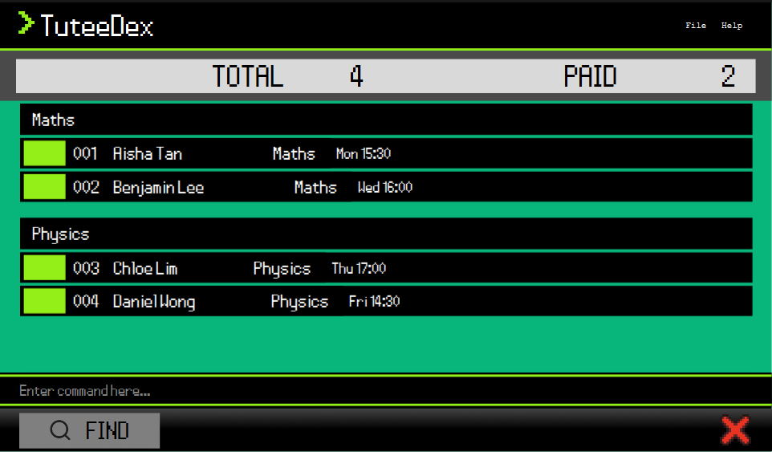

<link rel="stylesheet" href="stylesheets/landing.css">

<main class="landing-page">
  

    <a class="landing-wordmark" href="index.html" aria-label="TuteeDex home">&gt; TuteeDex</a>
    MADE FOR PRIVATE TUTORS
  

  <section class="landing-hero" aria-labelledby="landing-title">
    

      
YOUR TUTORING DESK

      <h1 id="landing-title">Less admin. More teaching.</h1>
      
Your students, lesson schedules, and tuition balances. 
        Together in one desktop app.

      
TuteeDex pairs quick, typed commands with a clear visual overview,
        so you can find a student, plan your next lesson, and keep track of what is owed.

      

        <a class="landing-button landing-button-primary" href="https://github.com/AY2627S1-CS2103T-F13-2/tp/releases">Get TuteeDex ↗</a>
        <a class="landing-button landing-button-secondary" href="UserGuide.html">Read the User Guide →</a>
      

      
Java 25 · Windows, macOS &amp; Linux · Desktop CLI + GUI

    

    <figure class="landing-preview">
      
 TUTEEDEX / DESKTOP PREVIEW

      
      <figcaption>The current desktop interface, with fictional example students. Click to enlarge.</figcaption>
    </figure>
  </section>

  <section class="landing-features" aria-labelledby="landing-features-title">
    

      
EXPLORE YOUR TOOLKIT

      <h2 id="landing-features-title">Keep the details. Find the overview.</h2>
      
Tools for the everyday work around your lessons.

    

    

      <button type="button" aria-pressed="true" aria-controls="feature-profiles">001 / Profiles</button>
      <button type="button" aria-pressed="false" aria-controls="feature-lessons">002 / Lessons</button>
      <button type="button" aria-pressed="false" aria-controls="feature-focus">003 / Focus</button>
      <button type="button" aria-pressed="false" aria-controls="feature-priorities">004 / Priorities</button>
      <button type="button" aria-pressed="false" aria-controls="feature-records">005 / Records</button>
      <button type="button" aria-pressed="false" aria-controls="feature-data">006 / Your data</button>
    

    

      <article class="landing-feature" id="feature-profiles">
        001 / PROFILES
        <h3>Know each student</h3>
        
Keep contact details, tuition start dates, subjects, tags, notes, and outstanding balances
          in one profile. View the details or edit just the fields that need changing.

        
OPEN A STUDENT PROFILE<code>view 1</code>

      </article>
      <article class="landing-feature" id="feature-lessons">
        002 / LESSONS
        <h3>See who you teach, and when</h3>
        
Give each subject a weekly lesson day and start time. Group students by subject while
          keeping each student's own lesson slot visible.

        
PUT UPCOMING LESSONS FIRST<code>sort slot/asc n/asc</code>

      </article>
      <article class="landing-feature" id="feature-focus">
        003 / FOCUS
        <h3>Find the right students</h3>
        
Search by name, filter by subject, or bring up a tag such as <code>needs revision</code>.
          Return to the active student list whenever you need the full picture.

        
FOCUS ON A SHARED TAG<code>list t/Needs revision</code>

      </article>
      <article class="landing-feature" id="feature-priorities">
        004 / PRIORITIES
        <h3>Put your next lesson first</h3>
        
Sort by upcoming lesson, name, tuition start date, or outstanding amount. Combine
          criteria and choose ascending or descending order for each.

        
SORT STUDENTS BY NAME<code>sort n/asc</code>

      </article>
      <article class="landing-feature" id="feature-records">
        005 / RECORDS
        <h3>Keep balances and records clear</h3>
        
See outstanding tuition amounts and total/paid student counts. Archive past students
          without deleting their profiles, and restore them when they return.

        
ARCHIVE A PAST STUDENT<code>archive 1</code>

      </article>
      <article class="landing-feature" id="feature-data">
        006 / YOUR DATA
        <h3>Bring your records with you</h3>
        
Export profiles to CSV for a copy outside the app. Preview a CSV import before
          confirming it. Your student records are stored locally on your computer.

        
EXPORT YOUR STUDENT RECORDS<code>export</code>

      </article>
    

  </section>

  <section class="landing-workflow" aria-labelledby="landing-workflow-title">
    

      
THE COMMAND DESK

      <h2 id="landing-workflow-title">A focused view is just a command away.</h2>
      
Type in the command box and press Enter. The student list updates in the same window;
        there is no need to work through a series of forms.

      
TuteeDex remembers your last list or find view and applied sort order when you close it,
        so you can pick up where you left off.

      <a class="landing-text-link" href="UserGuide.html#command-summary">Explore the commands →</a>
    

    

      

        
› <code>list t/Needs revision</code>

        Focus on students with this tag.
      

      

        
› <code>sort slot/asc n/asc</code>

        Order upcoming lessons, then break ties by name.
      

      

        
› <code>view 1</code>

        Open the first displayed student's full profile.
      

    

  </section>

  <section class="landing-start" aria-labelledby="landing-start-title">
    

      
YOUR FIRST SESSION

      <h2 id="landing-start-title">Set up your tutoring desk.</h2>
    

    <ol class="landing-steps">
      <li><h3>Get Java 25 ready</h3>
Check the setup instructions for your operating system in the
        <a href="UserGuide.html#quick-start">Quick Start guide</a>.
</li>
      <li><h3>Download the app</h3>
Choose a JAR from the
        <a href="https://github.com/AY2627S1-CS2103T-F13-2/tp/releases">team's releases</a>
        and put it in a folder where the app can save its files.
</li>
      <li><h3>Launch and explore</h3>
From that folder, run <code>java -jar "TuteeDex.jar"</code>
        using your downloaded filename. Enter <code>help</code> to see the commands.
</li>
    </ol>
    
This site describes the current development version.
      Check the release notes for the features included in your download.

  </section>

  <section class="landing-contribute" aria-labelledby="landing-contribute-title">
    

      
BUILT TOGETHER

      <h2 id="landing-contribute-title">Meet the people behind TuteeDex.</h2>
      
A CS2103T team project at the National University of Singapore,
        built on AddressBook-Level3 by the <a href="https://se-education.org">SE-EDU initiative</a>.

    

    

      <a href="AboutUs.html">Meet the team ↗</a>
      <a href="DeveloperGuide.html">Developer Guide ↗</a>
      <a href="https://github.com/AY2627S1-CS2103T-F13-2/tp">Source on GitHub ↗</a>
    

  </section>
  
Built with Java and JavaFX, with Jackson and JUnit.
    <a href="https://github.com/AY2627S1-CS2103T-F13-2/tp/actions/workflows/gradle.yml">Build status</a>
    ·
    <a href="https://codecov.io/gh/AY2627S1-CS2103T-F13-2/tp">Coverage report</a>
  

</main>
